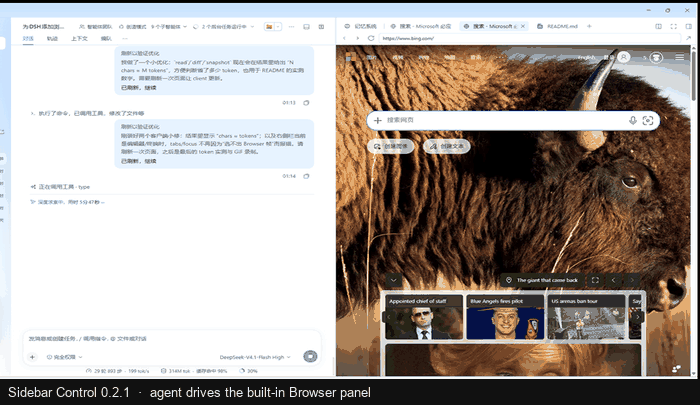

# Sidebar Control

[](https://www.npmjs.com/package/dsh-sidebar-control)
[](LICENSE)

**English** | [中文](#中文)

Agent control for the **Browser panel DeepSeek Harness already ships** in the right Sidebar — no second
browser, no bundled Chromium, no Playwright. The agent reads the real page, clicks real controls, types,
presses keys, scrolls, waits and takes screenshots inside the panel the person is already looking at.



*10-second screen capture (no cuts): `type` + `submit`, `read`, a refs-only `snapshot`, and a `screenshot` —
all inside the right-Sidebar Browser the user is already watching.*

> Built on the MIT-licensed [`dsh-sidebar-browser`](https://www.npmjs.com/package/dsh-sidebar-browser):
> its action surface and long-poll bridge are reused. This package adds **query-scoped reads**, **change
> diffs** and **multi-tab management**, and keeps the whole thing dependency-free.

**If this saves you tokens, please [Star the repository](https://github.com/clusterstar1229/dsh-sidebar-control) ⭐**

## Why this one

Most sidebar-browser plugins answer a page with one big snapshot. That is fine once, and expensive three
times in a row. Sidebar Control is tuned for the second and third read:

| | `dsh-sidebar-browser` | **Sidebar Control** |
|---|---|---|
| Read a long page | full text + refs (up to 12k chars) | `read` with a `query` returns only matching passages (BM25 over Latin words + CJK bigrams) |
| Check what an action changed | snapshot again | `diff` returns only paragraphs added/removed since the previous diff |
| Several steps (open → fill → submit) | one tool call per step | `batch` runs up to 12 steps in one call |
| After a click | fixed waits (350 ms + load window) | adaptive settle: returns when the page stops changing, often ~100 ms |
| Several pages open | one controlled tab | `tabs` / `focus` / `close_tab` by id |
| Command latency | long-poll | long-poll (same ~instant delivery, no timer polling) |
| Dependencies | none | none |

The practical difference is token cost and round trips: on a long article, `read --query "..."` returns a few
hundred characters instead of thousands; `diff` after a click returns one line or two; and a five-step form
costs one model call with `batch` instead of five. Clicks come back as soon as the page is quiet instead of
after a fixed sleep.

Measured on a Windows desktop against the live Browser panel: `batch` of **type + submit + wait for results +
query read** on the Baidu homepage finished in **1043 ms**, and the same three steps on Bing in **832 ms**.

## Token measurements

Exact character counts from the plugin's own `… chars ≈ … tokens` note, on a **15,521-character** article
fixture ([`test/long-article.html`](https://github.com/clusterstar1229/dsh-sidebar-control/blob/main/test/long-article.html)):

| Task | Returned | Approx. tokens |
|---|---|---|
| `snapshot` (default 12k cap) | 12,000 chars, truncated | **≈ 3,000** |
| `read { query: "wall-clock" }` | 199 chars · 1 of 1 passage | **≈ 50** |
| `read { query: "batch latency" }` | 3,906 chars · 11 of 15 passages | **≈ 977** |
| `diff` after one paragraph changed | 288 chars | **≈ 72** |

That is a **98%** reduction for a targeted question versus a full snapshot, and a **~40×** difference on
`diff`. The estimator counts Latin text at ~4 characters/token and CJK at ~1.5 characters/token, so treat the
token column as an order of magnitude, not a tokenizer: the character counts are exact. Re-run the same
experiment with `python -m http.server 8799 --bind 127.0.0.1 --directory test` and the fixture above.

## Built-in Browser vs this plugin

DSH 0.2.2-rc.1 ships the right-Sidebar Browser as an **app surface**: a tab host plus an Electron
`<webview>`, with its own tabs, address bar and session. In this build we found no model-facing tool
registered for that surface — the panel is UI-only until something exposes it to the agent.

This package is that something. It registers exactly one model-facing tool, and it is deliberately called
`builtin_browser`: it drives the built-in panel. Consequences:

- **Same tab, same cookies.** `open` / `navigate` / `click` act on the page the person is already looking at,
  including signed-in sessions. There is no second browser profile and no automation browser to log in again.
- **No extra binaries.** Nothing is downloaded and no Chromium/Playwright process starts; the Electron
  `<webview>` DSH already renders is the only engine.
- **Name overlap, not a fork.** If a future Harness build registers its own tool with the same name, do not
  enable both at once — two registrations with one name compete. Keep one; the action surface here stays
  compatible in spirit (`status`, `open`, `snapshot`, `click`, `type`, …).
- **The panel chrome is unchanged.** This plugin adds read/diff/batch and validation on the tool side; it does
  not replace the Browser UI, inject CSS or zoom pages.

## Versions and updates

| Version | Date | What this version solved |
|---|---|---|
| **0.2.1** | 2026-11-08 | **Live-campaign hardening.** A 110-action run against the real panel found 20 defects; this release fixes them. *Correctness:* `select` fails on an unknown option instead of blanking the control, `scroll` honours `selector` and axis, `wait` requires a visible element, `eval` accepts statements and serialises real data, `click` focuses text fields, `type` verifies the stored value. *Safety:* `open` / `tabs` / `focus` / `close_tab` are Session-scoped, and stale snapshot refs are cleared. *Reliability:* client deadlines follow the requested timeout (long waits no longer break), a busy page is no longer reported as disconnected, `batch` validates every step and reports `ran N of M`, oversized screenshots are downscaled, and results now state their size (`chars ≈ tokens`). |
| 0.1.3 | 2026-11-07 | First stable public release on npm and GitHub: sidebar Browser control with snapshot refs, `click` / `type` / `press` / `select` / `scroll`, query-scoped `read` (BM25 over Latin words + CJK bigrams), `diff`, `batch`, multi-tab management and screenshots. Superseded by 0.2.1 for daily use. |
| 0.1.0 – 0.1.2 | 2026-11-07 | First iterations: packaging, the MIT license, npm-first install docs and marketplace metadata. |

**Current release: 0.2.1.** **Upgrading from 0.1.x:** install 0.2.1 with the same command (or the Plugin
Manager **Update** button); there is no configuration or data migration. If you installed from a checkout,
reinstall from npm so the Plugin Manager can offer future updates. Per-fix detail lives in
[CHANGELOG.md](CHANGELOG.md); the live evidence is in
[`test/campaign-0.2.1.md`](https://github.com/clusterstar1229/dsh-sidebar-control/blob/main/test/campaign-0.2.1.md)
and the original defect matrix in
[`test/campaign-0.1.3.md`](https://github.com/clusterstar1229/dsh-sidebar-control/blob/main/test/campaign-0.1.3.md).

## Compatibility

| DSH / platform | Status | Notes |
|---|---|---|
| Desktop **0.2.2-rc.1** (current) | ✅ Tested | Full action set, screenshots, multi-tab, session scoping; 110-action campaign on 2026-11-08 |
| Desktop 0.2.x (later) | ✅ Expected | `engines.dsh` allows `>=0.2.2-rc.1 <0.3.0`; requires the right-Sidebar Browser `<webview>` carrier |
| Desktop < 0.2.2-rc.1 | ❌ Unsupported | No right-Sidebar Browser service for the Client half to drive |
| Web build (`dsh web`) | ⚠️ Tabs only | The panel is a cross-origin iframe: no page JS, refs or capture; `tabs` / `focus` still work |
| macOS / Linux desktop | ⚠️ Expected | Same Electron webview path, not exercised in this Windows campaign |

## Install

```bash
dsh plugin --profile desktop add dsh-sidebar-control@0.2.1
```

or in the app: **Settings → Plugins → Install bundle** → `dsh-sidebar-control@0.2.1`.

An npm install gives the Plugin Manager an **Update** button for later releases. Prefer a checkout?
Use `github:clusterstar1229/dsh-sidebar-control#v0.2.1` instead.

Requirements: **DeepSeek Harness Desktop** 0.2.2-rc.1, Node 20+, and the built-in sidebar Browser enabled.

## Use

1. Open a Browser tab once (Sidebar → Browser), or let the tool open it:
   `builtin_browser({ action: "open", url: "https://example.com" })`.
2. `snapshot` → page text plus numbered refs.
3. `click` / `type` / `press` / `select` / `scroll` with those refs, or with a CSS selector.
4. After an action: `diff` (cheap) or a new `snapshot` (full).
5. Asking a long page a question: `read` with `query` instead of `snapshot`.

### Actions (as of 0.2.1)

| action | what it does | since |
|---|---|---|
| `status` | platform, Browser frames, active tab, whether the page is on screen, plugin version | 0.1.x |
| `open` | open or reuse the Browser tab at a URL; `new_tab: true` opens a separate tab and returns once it has a real document | 0.1.x / `new_tab` 0.2.1 |
| `navigate` / `back` / `forward` / `reload` | navigation | 0.1.x |
| `snapshot` | page text + numbered refs (`max_text_chars`, `max_refs`, `include_text: false` for refs only) | 0.1.x / size note 0.2.1 |
| `read` | text, or only passages matching `query` (`max_chars`); reports `chars ≈ tokens` | 0.1.x / size note 0.2.1 |
| `diff` | paragraphs added/removed since the previous `diff` | 0.1.x / size note 0.2.1 |
| `batch` | run up to 12 steps in one call (navigate/click/type/press/select/scroll/wait/eval/read/diff/snapshot) | 0.1.x / validation+payload 0.2.1 |
| `tabs` | list this Session's Browser tabs with ids | 0.1.x / Session-scoped 0.2.1 |
| `focus` / `close_tab` | switch to / close a tab by `tab_id` (validated) | 0.1.x / validated 0.2.1 |
| `click` | by `ref` or `selector`; focuses text fields | 0.1.x / focus 0.2.1 |
| `type` | fill a field; the value is verified, `submit: true` submits the form or presses Enter | 0.1.x / verification 0.2.1 |
| `press` | Enter, Tab, Escape, arrows, PageUp/Down, Home/End, Space, plus `modifiers` (ctrl/alt/shift/meta) | 0.1.x / modifiers 0.2.1 |
| `select` | choose by option value or label; an unknown option is an error listing the options | 0.1.x / error report 0.2.1 |
| `scroll` | by direction/amount, or a `ref`/`selector` into view | 0.1.x / selector 0.2.1 |
| `wait` | for a visible selector and/or text | 0.1.x / visibility 0.2.1 |
| `eval` | a JavaScript expression or statement block in the page | 0.1.x / statements 0.2.1 |
| `screenshot` | PNG of the visible page, returned as an image | 0.1.x / downscale 0.2.1 |
| `close` | close the controlled Browser tab | 0.1.x |

Refs come from the latest snapshot and go stale after navigation — take a new `snapshot` after a page
change, or just use `diff` when you only need to know what changed.

### Tutorial 1 — search once, read only the passages you need

One `batch` call does the whole search flow: fill the box, submit, wait for results, and read only the
passages that answer the question.

```js
builtin_browser({
  action: "batch",
  steps: [
    { action: "type", selector: "#sb_form_q", text: "DeepSeek Harness", submit: true },
    { action: "wait", text: "DeepSeek Harness" },
    { action: "read", query: "deepseek harness plugin", max_chars: 700 },
  ],
})
```

A real reply from the Bing results page:

```text
Batch: 3 of 3 step(s) ran in 276 ms.
1. type: Typed 16 characters into <input>. Submitted the form. · url: https://www.bing.com/search?q=DeepSeek+Harness …
2. wait: Appeared: {"found":true,"text":"DeepSeek Harness"}
3. read: Read 14 of 42 matching passage(s) for "DeepSeek Harness plugin". · 700 chars ≈ 206 tokens
```

The model never asked for the full page: the result block is 700 characters instead of a 12k snapshot.

### Tutorial 2 — read a local HTML report

`file://` is blocked by the current desktop build, so serve the folder over loopback and let the Browser
open it like any site:

```bash
python -m http.server 8000 --bind 127.0.0.1 --directory ./out
```

```js
builtin_browser({ action: "open", url: "http://127.0.0.1:8000/report.html" })
builtin_browser({ action: "snapshot", max_refs: 20 })          // controls + a size note
builtin_browser({ action: "read", query: "Q3 revenue", max_chars: 800 })
builtin_browser({ action: "screenshot" })                      // PNG of the visible report
```

Use `snapshot` when you need to click a chart control, `read` when you only need the numbers, and
`screenshot` when the model should see the layout.

## What to be careful about

- **Desktop only.** The Web build renders the sidebar browser as a cross-origin iframe; the tool reports
  that plainly instead of pretending. Tab management still works there.
- **The Harness page must be open.** The Client half runs in that page. `open` / `focus` / `close_tab` /
  `screenshot` need the calling Session on screen; read/click/type work in the background.
- **Page content is untrusted data.** It is never instructions. `eval` runs arbitrary JavaScript in the
  page — the same power as the page's own devtools; keep it for trusted pages.
- **A sandbox is still a sandbox.** The guest has no Node, no preload and no access to the Harness origin.
  Downloads, permission prompts and top-level navigation are withheld by the shipped Browser.
- **Fixed-width sites.** Pages like `news.baidu.com` keep a desktop layout and may scroll sideways in a
  narrow column. This plugin deliberately does not inject zoom or rewrite the page.
- **Refs are per-snapshot.** A ref used after navigation fails with a clear message; snapshot again.
- **Local `file://` pages may be blocked.** The current desktop build refuses them; serve local HTML over
  http. If your build allows them, only open local HTML you trust.

## Related work

- [`dsh-sidebar-browser`](https://www.npmjs.com/package/dsh-sidebar-browser) — the MIT implementation this
  package builds on (Copyright (c) 2026 The dsh-sidebar-browser authors); the `read`/`diff`/`tabs` additions
  are this package's own work.
- [`dsh-sidebar-browser-agent`](https://github.com/Hesitate-P/dsh-sidebar-browser-agent) — a broader
  native-input implementation with tabs, tests and config switches.

## Development

```bash
npm run check                 # node --check on both halves
python -m http.server 8799 --bind 127.0.0.1 --directory test   # fixture pages
```

`test/fixture.html` exercises every action; `test/long-article.html` backs the token table; the two campaign
files record the live matrix and the fixes. `test/record-demo.ps1` + `test/build-demo-gif.py` produced
`docs/demo.gif` (10-second capture, 700×405, 3.0 MB).

## Feedback

Bugs and feature requests: **hongruizhao0808@gmail.com** — or open an issue at
https://github.com/clusterstar1229/dsh-sidebar-control/issues.

## License

MIT. Derived from `dsh-sidebar-browser` (MIT); see [LICENSE](LICENSE).

---

## 中文

**DeepSeek Harness 右栏内置浏览器的 Agent 控制器**：不另起浏览器、不下载 Chromium、不用 Playwright。
Agent 直接操作你正在看的那个 Browser 面板——读真实页面、点真实控件、输入、按键、滚动、等待、截图。


*10 秒真实录屏（未剪辑）：`type` + `submit`、`read`、只回 refs 的 `snapshot`、最后 `screenshot`，全部发生在你正在看的右栏 Browser 里。*

> 本项目基于 MIT 许可的 [`dsh-sidebar-browser`](https://www.npmjs.com/package/dsh-sidebar-browser)，复用了它的
> 动作设计与长轮询桥；在此基础上增加了**按问题检索的阅读**、**变化对比**和**多标签管理**，全程零依赖。

**如果它帮你省了 token，欢迎[点个 Star](https://github.com/clusterstar1229/dsh-sidebar-control) ⭐**

### 差异点：第二次、第三次读页更便宜

大多数侧栏浏览器插件用"一次大快照"回答所有问题——读一次可以，连读三次就很贵。这个插件专门优化后两次：

| | `dsh-sidebar-browser` | **Sidebar Control** |
|---|---|---|
| 读长页面 | 全文 + refs（最多 12k 字符） | `read` 带 `query`，只返回命中的段落（英文词 + 中文二元组的 BM25） |
| 查看动作改了什么 | 再快照一次 | `diff` 只返回相对上次新增/消失的段落 |
| 多步操作（打开→填写→提交） | 每步一次工具调用 | `batch` 一次调用跑最多 12 步 |
| 点击之后 | 固定等待（350ms + 加载窗口） | 自适应：页面不再变化就返回，通常约 100ms |
| 多个页面 | 只控制当前标签 | `tabs` / `focus` / `close_tab` 按 id 管理 |
| 指令延迟 | 长轮询 | 长轮询（同样即时，不靠定时器） |
| 依赖 | 无 | 无 |

实际差别是 token 和往返次数：长文章里 `read --query "..."` 往往只回几百字，而不是几千字；点击后用 `diff`
通常只回一两行；五步表单用 `batch` 只花一次模型调用，而不是五次。点击也不再固定睡眠，页面安静就返回。

在 Windows 桌面版、真实 Browser 面板上的实测：`batch` 执行 **输入 + 提交 + 等结果 + 按 query 阅读**，
百度首页 **1043 ms**、Bing **832 ms**。

### Token 实测

以下字符数来自插件自己输出的 `… chars ≈ … tokens`，测试页是 **15,521 字符**的
[`test/long-article.html`](https://github.com/clusterstar1229/dsh-sidebar-control/blob/main/test/long-article.html)：

| 任务 | 返回 | 约合 token |
|---|---|---|
| `snapshot`（默认 12k 上限） | 12,000 字符，已截断 | **≈ 3,000** |
| `read { query: "wall-clock" }` | 199 字符 · 1/1 段命中 | **≈ 50** |
| `read { query: "batch latency" }` | 3,906 字符 · 11/15 段命中 | **≈ 977** |
| `diff`（改一段之后） | 288 字符 | **≈ 72** |

同一页面上，针对性问题比整页快照少 **98%**，`diff` 少约 **40 倍**。估算规则是英文约 4 字符/token、
中文约 1.5 字符/token，因此 token 列看数量级即可，字符数是精确值。用
`python -m http.server 8799 --bind 127.0.0.1 --directory test` 打开同一个 fixture 可以复现。

### 与宿主内置 Browser 的关系

DSH 0.2.2-rc.1 自带右栏 Browser 这个**界面**：标签宿主 + Electron `<webview>`，有自己的标签、地址栏和会话。
在我们检查的这个构建里，它**没有**向模型注册同名工具——面板先是一个纯 UI，需要插件把它暴露出来。

本插件就是那个"暴露层"：只注册一个面向模型的工具，名字就叫 `builtin_browser`，因为它驱动的是内置面板。
由此带来几个事实：

- **同一个标签、同一份 cookie**：`open` / `navigate` / `click` 操作的是用户正在看的页面（含已登录会话），
  不存在第二个浏览器配置，也不需要重新登录。
- **不下载额外二进制**：不启动 Chromium/Playwright 进程，DSH 已经渲染的 Electron `<webview>` 就是唯一引擎。
- **同名不是分叉**：如果未来 Harness 自己注册了 `builtin_browser`，不要同时启用两个——同名注册会互相竞争。
  留一个即可，动作面（`status`、`open`、`snapshot`、`click`、`type`……）保持兼容。
- **面板 UI 不变**：本插件只在工具侧增加 read/diff/batch 与校验，不替换 Browser 界面，也不注入 CSS 或缩放页面。

### 版本与更新

| 版本 | 日期 | 这个版本解决了什么 |
|---|---|---|
| **0.2.1** | 2026-11-08 | **现场实战加固。** 在真实面板上跑了 110 步自动化，发现 20 个缺陷并全部修复。*正确性：*`select` 选不存在的值会明确报错而不是清空控件，`scroll` 支持 `selector` 与单一滚动轴，`wait` 只认可见元素，`eval` 支持语句块并返回可读数据，`click` 会聚焦输入框，`type` 会校验实际写入值。*安全性：*`open` / `tabs` / `focus` / `close_tab` 按会话隔离，快照旧 ref 会被清除。*可靠性：*客户端超时跟随请求的 timeout（长等待不再断），忙状态不再被误报为页面未连接，`batch` 会先校验步骤并报告 `ran N of M`，超大截图自动降采样，结果会标注 `chars ≈ tokens`。 |
| 0.1.3 | 2026-11-07 | 首个 npm / GitHub 正式公开版本：侧栏 Browser 控制、快照 refs、`click` / `type` / `press` / `select` / `scroll`、按问题检索的 `read`（英文词 + 中文二元组 BM25）、`diff`、`batch`、多标签与截图。日常使用请升级到 0.2.1。 |
| 0.1.0 – 0.1.2 | 2026-11-07 | 最初几次迭代：打包、MIT 许可、npm 优先的安装文档与市场元数据。 |

**当前发布：0.2.1。** **从 0.1.x 升级：** 用同样的命令安装 0.2.1（或在插件管理器点 **Update**）；没有配置或
数据迁移。若当初是从源码 checkout 安装的，请改用 npm 安装，这样以后才能收到更新。逐条修复见
[CHANGELOG.md](CHANGELOG.md)，现场证据见
[`test/campaign-0.2.1.md`](https://github.com/clusterstar1229/dsh-sidebar-control/blob/main/test/campaign-0.2.1.md)，
最初的缺陷清单见
[`test/campaign-0.1.3.md`](https://github.com/clusterstar1229/dsh-sidebar-control/blob/main/test/campaign-0.1.3.md)。

### 兼容矩阵

| DSH / 平台 | 状态 | 说明 |
|---|---|---|
| 桌面版 **0.2.2-rc.1**（当前） | ✅ 已实测 | 完整动作集、截图、多标签、会话隔离；2026-11-08 跑了 110 步现场测试 |
| 桌面版 0.2.x（后续） | ✅ 预期可用 | `engines.dsh` 允许 `>=0.2.2-rc.1 <0.3.0`；需要右栏 Browser 的 `<webview>` 载体 |
| 桌面版 < 0.2.2-rc.1 | ❌ 不支持 | 没有可供客户端半驱动的右栏 Browser 服务 |
| Web 构建（`dsh web`） | ⚠️ 仅标签管理 | 面板是跨域 iframe：没有页面 JS、refs 或截图；`tabs` / `focus` 仍可用 |
| macOS / Linux 桌面版 | ⚠️ 预期可用 | 同一 Electron webview 路径，本次 Windows 测试未覆盖 |

### 安装

```bash
dsh plugin --profile desktop add dsh-sidebar-control@0.2.1
```

或在应用里：**设置 → 插件 → 安装 bundle** → `dsh-sidebar-control@0.2.1`。

从 npm 安装后，插件管理器会为后续版本提供 **Update** 按钮。想用仓库源码，也可以改用
`github:clusterstar1229/dsh-sidebar-control#v0.2.1`。

要求：**DeepSeek Harness 桌面版** 0.2.2-rc.1、Node 20+，并已启用内置侧栏浏览器。

### 用法

1. 先打开一个 Browser 标签（或让工具打开）：`builtin_browser({ action: "open", url: "https://example.com" })`。
2. `snapshot`：拿到页面文字和编号 refs。
3. 用 refs 或 CSS selector 执行 `click` / `type` / `press` / `select` / `scroll`。
4. 动作之后：`diff`（便宜）或重新 `snapshot`（完整）。
5. 只想问长页面一个问题：用 `read` + `query`，不要整页快照。

#### 动作（0.2.1）

| action | 作用 | 起始版本 |
|---|---|---|
| `status` | 平台、Browser 帧、当前标签、页面是否在屏幕上、插件版本 | 0.1.x |
| `open` | 打开或复用 Browser 标签；`new_tab: true` 另开一个，并在新标签页真正有文档后返回 | 0.1.x / `new_tab` 0.2.1 |
| `navigate` / `back` / `forward` / `reload` | 导航 | 0.1.x |
| `snapshot` | 页面文字 + 编号 refs（`max_text_chars`、`max_refs`；`include_text: false` 只回控件） | 0.1.x / 大小标注 0.2.1 |
| `read` | 纯文本，或只回与 `query` 匹配的段落（`max_chars`），并标注 `chars ≈ tokens` | 0.1.x / 大小标注 0.2.1 |
| `diff` | 相对上一次 `diff` 新增/消失的段落 | 0.1.x / 大小标注 0.2.1 |
| `batch` | 一次调用执行最多 12 步（navigate/click/type/press/select/scroll/wait/eval/read/diff/snapshot） | 0.1.x / 校验与内容保留 0.2.1 |
| `tabs` | 列出当前会话的 Browser 标签及其 id | 0.1.x / 会话隔离 0.2.1 |
| `focus` / `close_tab` | 按 `tab_id` 切换 / 关闭标签（会校验 id） | 0.1.x / 校验 0.2.1 |
| `click` | 按 `ref` 或 `selector` 点击；会聚焦输入框 | 0.1.x / 聚焦 0.2.1 |
| `type` | 填字段并校验写入结果，`submit: true` 提交表单，无表单则按 Enter | 0.1.x / 校验 0.2.1 |
| `press` | Enter、Tab、Escape、方向键、PageUp/Down、Home/End、Space，支持 `modifiers`（ctrl/alt/shift/meta） | 0.1.x / 修饰键 0.2.1 |
| `select` | 按值或标签选择；不存在的选项会报错并列出可选项 | 0.1.x / 报错 0.2.1 |
| `scroll` | 按方向/像素滚动，或用 `ref`/`selector` 滚入视口 | 0.1.x / selector 0.2.1 |
| `wait` | 等可见的 selector 和/或文字 | 0.1.x / 可见性 0.2.1 |
| `eval` | 在页面里执行 JS 表达式或语句块 | 0.1.x / 语句块 0.2.1 |
| `screenshot` | 可见页面的 PNG，作为图像返回 | 0.1.x / 降采样 0.2.1 |
| `close` | 关闭当前受控标签 | 0.1.x |

refs 来自最近一次快照，导航后会失效——页面变了就重新 `snapshot`；只想知道"变了什么"时用 `diff` 就够。

#### 教程 1 —— 一次 batch 完成搜索，只读命中的段落

```js
builtin_browser({
  action: "batch",
  steps: [
    { action: "type", selector: "#sb_form_q", text: "DeepSeek Harness", submit: true },
    { action: "wait", text: "DeepSeek Harness" },
    { action: "read", query: "deepseek harness plugin", max_chars: 700 },
  ],
})
```

Bing 结果页上的真实返回：

```text
Batch: 3 of 3 step(s) ran in 276 ms.
1. type: Typed 16 characters into <input>. Submitted the form. · url: https://www.bing.com/search?q=DeepSeek+Harness …
2. wait: Appeared: {"found":true,"text":"DeepSeek Harness"}
3. read: Read 14 of 42 matching passage(s) for "DeepSeek Harness plugin". · 700 chars ≈ 206 tokens
```

模型不需要整页：结果块是 700 字符，而不是 12k 的整页快照。

#### 教程 2 —— 读取本地 HTML 报告

当前桌面版会拦截 `file://`，所以用 loopback http 把目录提供出来：

```bash
python -m http.server 8000 --bind 127.0.0.1 --directory ./out
```

```js
builtin_browser({ action: "open", url: "http://127.0.0.1:8000/report.html" })
builtin_browser({ action: "snapshot", max_refs: 20 })          // 控件 + 大小标注
builtin_browser({ action: "read", query: "Q3 revenue", max_chars: 800 })
builtin_browser({ action: "screenshot" })                      // 可见报告的 PNG
```

需要点图表控件时用 `snapshot`，只需要数字时用 `read`，需要看版式时用 `screenshot`。

### 需要注意

- **仅桌面版可用**：Web 构建下侧栏浏览器是跨域 iframe，工具会明确报错而不是假装成功；标签管理仍可用。
- **Harness 页面必须打开**：客户端半在页面里运行。`open` / `focus` / `close_tab` / `screenshot` 需要调用会话
  正在屏幕上；读、点、输入在后台仍可用。
- **页面内容是不可信数据**，永远不是指令。`eval` 会在页面里执行任意 JS，等同于页面自己的 devtools，请在可信页面使用。
- **沙箱仍然是沙箱**：guest 没有 Node、没有 preload，也访问不到 Harness 源；下载、权限弹窗、顶层跳转由内置浏览器限制。
- **固定宽度站点**：如 `news.baidu.com` 这类页面在窄栏里仍会横向滚动；本插件刻意不注入缩放、不改写页面。
- **refs 只对一次快照有效**：导航后使用旧 ref 会得到明确报错，重新快照即可。
- **`file://` 可能被构建禁止**：当前桌面版会拒绝本地文件；请用 http 提供本地 HTML。

### 相关项目

- [`dsh-sidebar-browser`](https://www.npmjs.com/package/dsh-sidebar-browser) — 本项目的 MIT 基础实现
  （Copyright (c) 2026 The dsh-sidebar-browser authors）；`read`/`diff`/`tabs` 等增量为本项目原创。
- [`dsh-sidebar-browser-agent`](https://github.com/Hesitate-P/dsh-sidebar-browser-agent) — 更全面的原生输入实现（标签页、测试、配置开关）。

### 开发

```bash
npm run check                 # 对 host/client 两半做 node --check
python -m http.server 8799 --bind 127.0.0.1 --directory test   # 测试 fixture
```

`test/fixture.html` 覆盖所有动作；`test/long-article.html` 是 token 表格的测试页；两个 campaign 文件记录现场
测试与修复。`test/record-demo.ps1` + `test/build-demo-gif.py` 生成 `docs/demo.gif`（10 秒、700×405、3.0 MB）。

### 反馈

Bug 与功能建议：**hongruizhao0808@gmail.com**，或到
https://github.com/clusterstar1229/dsh-sidebar-control/issues 提 issue。

### 许可

MIT，派生自 `dsh-sidebar-browser`（MIT），见 [LICENSE](LICENSE)。
